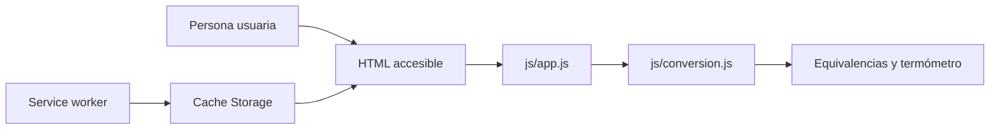
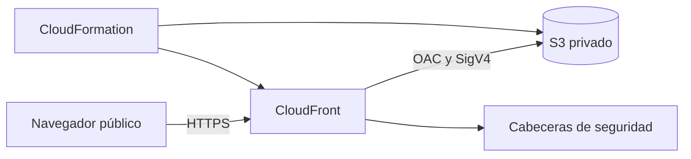

# Arquitectura

## Aplicación

Termia es una PWA estática. No tiene backend, cuentas, base de datos ni telemetría: la entrada se convierte localmente en el navegador.

`conversion.js` contiene las fórmulas y validación sin DOM. `app.js` presenta resultados. `pwa.js` controla instalación, tema, ayuda, actualización, Window Controls Overlay y Compartir. La cabecera contiene exactamente cinco controles interactivos; el único control Compartir usa Web Share o copia la URL actual y anuncia el resultado en una región viva.

El manifest solicita `window-controls-overlay` con fallback `standalone`. La cabecera usa las variables `titlebar-area-*`; sus controles son `app-region: no-drag`. Sin WCO, conserva una cabecera web normal. El service worker `termia-v2` instala primero el shell completo y solo elimina caches anteriores al activar la nueva versión; la activación anticipada requiere confirmación de la persona usuaria.

## Publicación web

GitHub Pages recibe un `_site` construido con una allowlist de 14 archivos. No se publican infraestructura, scripts, documentación, fuentes de iconos, reportes ni estado local.

## Alternativa AWS

CloudFront es público porque la PWA está destinada a acceso anónimo. S3 permanece privado y solo concede `s3:GetObject` al servicio CloudFront cuando `AWS:SourceArn` coincide con la distribución creada. Un `Deny` separado rechaza transporte inseguro.

CloudFormation crea exactamente bucket, OAC, política de cabeceras, distribución y bucket policy. No configura website endpoint, acceso público S3, CORS, IAM, DNS, dominio propio, WAF, logs ni código de borde. El bucket usa SSE-S3, versionado, retención y Object Ownership sin ACL.

La CSP permite únicamente recursos del mismo origen; Web Share y escritura al portapapeles se limitan a `self`. HSTS no incluye subdominios porque el certificado predeterminado usa un dominio compartido que el proyecto no controla.
