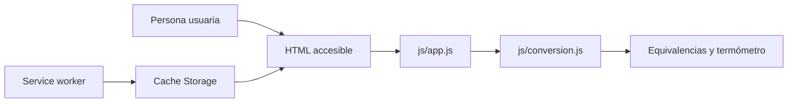
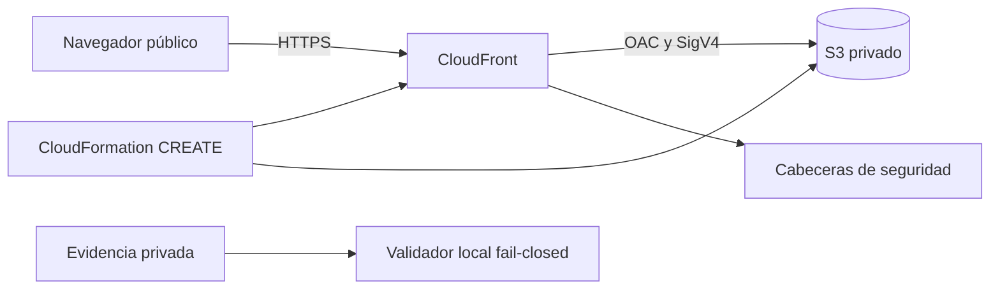

# Arquitectura

## Aplicación

Termia es una PWA estática. No tiene backend, cuentas, base de datos ni telemetría: la entrada se convierte localmente en el navegador.

`conversion.js` contiene fórmulas y validación sin DOM. `app.js` presenta resultados. `pwa.js` controla instalación, tema, ayuda, actualización, Window Controls Overlay y Compartir. La cabecera conserva exactamente cinco controles y un único Compartir. Este abre un `<dialog>` independiente —centrado en escritorio y como hoja inferior en móvil— cuyos destinos de WhatsApp, Telegram, Facebook, X y Correo se generan al abrir desde `window.location.href`. Más apps invoca Web Share solo tras su selección explícita; si no existe se desactiva sin afectar las alternativas. Copiar enlace es la única ruta al portapapeles y encadena Clipboard API, `execCommand` y selección manual accesible, sin copiar ante cancelaciones o errores de Web Share.

El manifest prioriza `window-controls-overlay` con fallback `standalone`. La cabecera usa las variables `titlebar-area-*` y sus controles son `app-region: no-drag`. Sin WCO conserva una cabecera web normal. El service worker mantiene su flujo explícito de actualización, precarga los mismos 14 recursos del shell y solo intercepta solicitudes del mismo origen. La hoja, Correo y la copia funcionan desde el shell sin conexión; los destinos sociales necesitan red y nunca se almacenan en Cache Storage.

## Publicación web

GitHub Pages recibe un `_site` construido con una allowlist de 14 archivos. No se publican infraestructura, scripts, documentación, pruebas, reportes ni estado local.

## Alternativa AWS

CloudFront es público porque la PWA está destinada a acceso anónimo. S3 permanece privado con cuatro Block Public Access y solo concede `s3:GetObject` al servicio CloudFront cuando `AWS:SourceArn` coincide con la distribución creada. Un `Deny` separado rechaza transporte inseguro.

CloudFormation define exactamente bucket, OAC, política de cabeceras, distribución y bucket policy. No configura website endpoint, acceso público S3, CORS, IAM, DNS, dominio propio, WAF, logs, macros, nested stacks, imports ni código de borde. El bucket usa SSE-S3, versionado, `BucketOwnerEnforced`, `DeletionPolicy: Retain` y `UpdateReplacePolicy: Retain`.

## Flujo trazable de creación

El único target propuesto es `termia-pwa-public-prod`, con `prod` y `PriceClass_100` fijados internamente. Cualquier existencia o incertidumbre produce STOP; no hay update, delete, fallback de nombre ni cleanup.

`prepare` genera internamente un attempt ID, nombre de change set y client token, persiste la identidad normalizada antes de crear y conserva evidencia privada `0700/0600`. Dos probes de ausencia preceden al inicio capturado de `CreateChangeSet` por un máximo de 60 segundos; CloudTrail debe igualar el request ID exacto de `DescribeStacks`. Para la creación debe correlacionar operación exitosa, identidad, región, tiempo, stack, nombre, token e ID del change set; sus campos no garantizados pueden faltar, pero cualquier valor presente debe concordar. El template remoto debe coincidir byte por byte con la plantilla ASCII+LF y con el blob del commit.

El validador deriva la semántica `CREATE` de todas las fuentes en conjunción. No depende de que `DescribeChangeSet` devuelva `ChangeSetType`, campo que puede estar ausente; sí rechaza contradicciones. El request sellado, la respuesta y los snapshots imponen la descripción y opciones completas, un placeholder `REVIEW_IN_PROGRESS` vacío, un solo change set disponible sin role/notificaciones/imports/rollback triggers, `OnStackFailure=DO_NOTHING`, modo `STANDARD`, parámetros/tags exactos y cinco `Add` allowlisted.

Antes de execute se repite la conjunción con un snapshot TOCTOU donde cada observación, desde la primera, tiene máximo 300 segundos. Después del reporte y el sellado, un segundo guard completo se ejecuta inmediatamente antes de la llamada, exige igualdad exacta entre el token del puntero, el intento sellado y la evidencia, y comparte su timestamp UTC con la captura de `execute-change-set`. La llamada consume stack, change set y token del guard aprobado; una alteración o demora posterior al primer PASS falla cerrada. Los valores completos quedan privados; los reportes compartibles solo contienen hashes y booleanos. Este workflow no hizo llamadas AWS.

La CSP permite únicamente recursos del mismo origen; Web Share y escritura al portapapeles se limitan a `self`. HSTS no incluye subdominios porque el certificado predeterminado usa un dominio compartido que el proyecto no controla.
